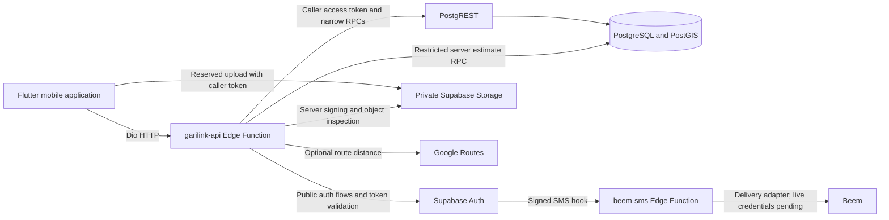
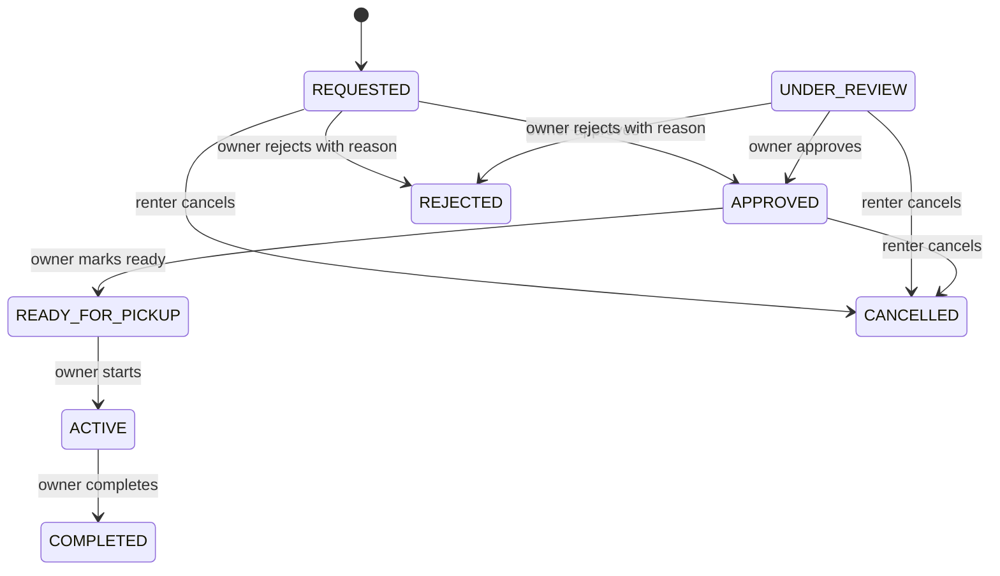

# Current GariLink architecture

Source baseline: `d54423cfb89b1b82f936dfaf63c5b45ef596360d`, inspected on 2026-11-08. This document describes checked-in behavior, not the state of a hosted deployment. The [handover](../SENIOR_DEVELOPER_HANDOVER.md) records branches, unfinished work, and certification evidence.

## Product and system boundary

GariLink is a vehicle rental and transport-access marketplace for Tanzania. A renter discovers a suitable vehicle and sends a rental request. An individual owner or fleet operator manages vehicles and rental operations within a workspace. One account may use both renter and owner journeys.

Renters browse free. Rental settlement is arranged between the parties outside GariLink: an estimate, approved request, or completed rental is not proof of payment. Workspace subscriptions are the intended separate business model; subscription and Snippe implementation under development are not part of this source baseline.

The active mobile source is [mobile_flutter](../../mobile_flutter/). The backend source is [supabase](../../supabase/): Auth, PostgreSQL, Storage, and Deno Edge Functions. `backend/` (NestJS/Prisma) and `mobile/` (React Native/Expo) are preserved legacy implementations. Their manifests and deployment files do not define the current Flutter/Supabase runtime. Hosted cutover and migration reconciliation still require independent evidence.

## Flutter application

The entry point is [main.dart](../../mobile_flutter/lib/main.dart). It initializes preferences and secure storage, installs an error-reporting boundary, creates a Riverpod `ProviderScope`, and starts `MaterialApp.router`. The supported application theme is currently light; a dark theme definition exists but is not selected by the app.

| Area | Actual responsibility |
| --- | --- |
| `lib/core/` | Environment selection, API/storage services, navigation, validation, formatting, and FLEX design tokens |
| `lib/shared/widgets/` | Shared controls, loading/error states, and layout components |
| `lib/features/*/presentation/` | Pages, widgets, and Riverpod providers or controllers |
| `lib/features/*/data/` | API repositories and serialization |
| `lib/features/*/domain/` | Models and business concepts such as transport need, pricing, rental summaries, and workspace context |

This is a feature-oriented codebase with partial layering, not a uniformly enforced clean-architecture implementation. `AuthNotifier` is a `StateNotifier`; query state uses `StateProvider`, `FutureProvider`, and provider families. Several repositories return JSON maps, while rental, transport, and workspace paths have typed models. Some pages call repositories directly. Reducing large widgets and map-based contracts is technical debt; adding mandatory layers or code generation everywhere would misrepresent the existing design.

### Navigation and state

[app_router.dart](../../mobile_flutter/lib/core/navigation/app_router.dart) defines GoRouter routes, a shared tab shell, authenticated routes, and owner navigation. Owner mode is UI state, not authorization. [operator_workspace_provider.dart](../../mobile_flutter/lib/features/owner/presentation/providers/operator_workspace_provider.dart) holds the selected workspace and filters workspace inventory. Backend checks still apply to every mutation.

[booking_continuation.dart](../../mobile_flutter/lib/core/navigation/booking_continuation.dart) retains only a validated public listing ID for at most ten minutes across sign-in. It discards prices, dates, locations, and notes. After login the client reloads the listing for review; it does not automatically send a rental request. Account changes clear the continuation.

### HTTP, credentials, and errors

[ApiClient](../../mobile_flutter/lib/core/services/api_client.dart) wraps Dio. Public auth requests do not receive a stored bearer token. Private requests use the current access token. A single refresh operation handles concurrent 401 responses, rotates tokens, and retries once; session revisions prevent a late request from crossing a local sign-out/account change. Server and transport failures become typed `AppException` subclasses with safe product messages.

[StorageService](../../mobile_flutter/lib/core/services/storage_service.dart) stores credentials and pending verification data in `flutter_secure_storage`; non-sensitive preferences use `shared_preferences`. [AppEnvironment](../../mobile_flutter/lib/core/config/app_environment.dart) requires an explicit API endpoint for development. A release build defaults to the configured production environment, so build intent must be reviewed. The known production-host normalization issue is tracked as unfinished work, not silently corrected by this documentation.

## Auth and authorization

The mobile client talks to [garilink-api](../../supabase/functions/garilink-api/handler.ts), not directly to the Supabase Auth SDK. The facade implements email signup, confirmation, password login/recovery, token refresh/logout, and legacy phone signup/OTP endpoints. Private facade routes validate the bearer token with Auth's `/user` endpoint before database operations.

The effective [email-first authorization migration](../../supabase/migrations/20261009000000_email_first_preparation_access.sql) makes the database authoritative for account access:

- `require_user(false)` requires a matching live `auth.sessions` row, an active application account, a non-anonymous and non-banned Auth user, and a confirmed email or legacy confirmed phone.
- The default `require_user()` additionally requires Auth-confirmed phone ownership for sensitive operations such as rental requests and publication.
- Preparation operations allow a confirmed-email account to edit its profile, create an authorized workspace, and prepare private vehicle drafts without pretending phone verification is complete.
- Workspace access is derived from the authenticated actor, workspace activity, ownership, active membership, and the required role/capability. A client-supplied workspace ID is a target, not a grant.

Signed-in phone linking is incomplete in this baseline: the legacy OTP flow is a sign-in flow and cannot be treated as a safe same-account phone-change flow. The separate phone-linking worktree must be finished, reviewed, and certified before it is integrated.

## Database and migrations

The baseline has 34 ordered migrations in [supabase/migrations](../../supabase/migrations/). Later migrations replace earlier RPC bodies, so reading only the first definition is insufficient. `public.gl_*` tables hold application accounts, profiles, roles/capabilities, workspaces/members, vehicles/listings, saved listings, media reservations, rentals, and pricing/estimate state. `garilink_private` holds internal helpers and closed verification records. Supabase owns the `auth` and `storage` schemas; `extensions` holds required extensions including PostGIS and GiST support.

Application tables use RLS and restricted grants. The principal application contract consists of narrowly granted RPCs, many implemented as `SECURITY DEFINER` with an empty `search_path` and explicit actor/tenant checks. Their safety depends on those checks and grants, not on the function keyword or RLS alone. Raw table access, RPC authorization, and Storage policies are separate boundaries and need separate tests.

Two server-only exceptions to caller-token access are important:

1. The facade signs already-authorized vehicle-media paths through Storage using its service-role credential.
2. The route-backed estimate path calls a restricted estimate RPC with the authenticated actor ID derived from Auth and the trusted provider result. Client-supplied distances or actor IDs must not become authoritative.

The [SMS delivery ledger](../../supabase/functions/beem-sms/ledger.ts) also uses a service-role credential through narrow RPCs. A statement that *only* the SMS hook uses service-role access would be inaccurate.

## Discovery, vehicles, and booking

The physical vehicle and its marketplace listing remain distinct records owned by a workspace. V2 adds relational category/availability fields and a validated, versioned JSON capability document. Owner tools prepare a private draft, attach media, configure operational location and pricing, and request publication. Server eligibility and capability checks remain authoritative.

Public routes support listing search/detail, discoverable vehicles, PostGIS nearby queries, and transport-need matching. Public projections omit exact operational coordinates. [Explore providers](../../mobile_flutter/lib/features/explore/presentation/providers/explore_provider.dart) currently load one query page; the default 30-result UI limit is known unfinished pagination work.

Publication and manual operational availability are independent. The effective [availability policy](../../supabase/migrations/20260923000000_owner_workspace_context_and_availability_policy.sql) blocks new V2 requests while any rental for the vehicle is `APPROVED`, `READY_FOR_PICKUP`, or `ACTIVE`; it does not automatically rewrite the owner's manual availability. This conservative rule is broader than checking only the newly requested dates.

Rental creation revalidates publication, account access, self-rental restrictions, requestability, and transport suitability. Requests use a caller/request UUID and canonical payload for retries; a changed payload under the same request ID conflicts. The database snapshots transport need, pickup/destination, and an available authoritative price estimate. Vehicle descriptive information is still read from current vehicle records, not a complete immutable vehicle-identity snapshot.

Pricing and distance estimates are server-derived. Google Routes is the implemented route provider. Unavailable routing is reported as unavailable; a straight-line estimate is not substituted. Currency is TZS. Rental pricing's existing amount representation must be checked before mapping it to a separate subscription/payment provider contract.

## Rental lifecycle

The effective lifecycle actions are defined in [the rental migration](../../supabase/migrations/20260912000000_rentals.sql) and exposed through [RentalRepository](../../mobile_flutter/lib/features/trips/data/repositories/rental_repository.dart).

`UNDER_REVIEW` is accepted by the schema and transition checks, but this baseline exposes no action that enters that state. Rental actions lock the row, reject invalid transitions, and use a database exclusion constraint to prevent overlapping confirmed rentals. Creation requires pickup after the current database date and return after pickup; same-day pickup is not enabled. Approval of stale requests and automatic expiry need additional work: there is no implemented `EXPIRED` rental state or expiry worker here.

## Storage and SMS

[VehicleMediaRepository](../../mobile_flutter/lib/features/owner/data/vehicle_media_repository.dart) handles selection/compression, reservation, caller-authenticated Storage upload, and finalization. Media remains in a private bucket. SQL reservation/finalization rules and Storage object policies are both required; rendered URLs are temporary signed URLs, not public bucket access. Ready media can be reordered or deleted through the authorized owner workflow. Account/session revocation behavior at the direct Storage boundary remains a targeted security gap to certify.

[beem-sms](../../supabase/functions/beem-sms/index.ts) verifies Standard Webhooks signatures before delivery and uses a durable message-ID ledger to avoid blindly retrying uncertain sends. Unit tests mock delivery. Live Beem credentials, sender approval, and authorized device delivery testing remain pending. No document or passing mock test establishes actual SMS delivery.

## Verification, privacy, and operational limits

Phone ownership and identity/KYC verification are distinct. The [closed verification migration](../../supabase/migrations/20261012000000_verification_closed_foundation.sql) creates private records with client access revoked and policy approval disabled. It does not enable public evidence uploads, reviewer decisions, or KYC enforcement. Divergent identity/security branches must not be merged merely because they contain more code.

The intended contact policy is explicit consent between actual approved rental parties. It is **not implemented correctly in this baseline**: the effective `rental_json(..., true)` serializer includes the customer's phone in workspace rental responses without a consent/status check. This is a release blocker, not a privacy guarantee. Precise rental locations also require lifecycle-specific disclosure review.

Workspace subscriptions, payment reconciliation, consent-based contact sharing, account deletion, hosted drift reconciliation, and production observability are unfinished or separate workstreams. [SafeErrorReporter](../../mobile_flutter/lib/core/services/error_reporter.dart) has a debug-only output boundary and no configured production crash sink. Member invitations, advanced fleet analytics, dispatch, realtime tracking, and chat are not delivered by the current owner/fleet screens.

## Architecture decisions retained by the cleanup

| Decision | Why it remains |
| --- | --- |
| Flutter + Supabase is the development architecture | Current client endpoint, repositories, migrations, and CI operate on these directories |
| Workspace is the ownership/authorization boundary | One account can rent independently and participate in multiple owner/fleet workspaces |
| Vehicle and listing remain separate | Physical-asset identity and publication lifecycle have different responsibilities |
| Auth and database state authorize sensitive actions | Stale UI state, metadata, and decoded JWT claims alone cannot grant access |
| Rental settlement remains off-platform | Rental lifecycle and estimated amounts do not create payment receipts or escrow |
| Keep legacy source and historical reports accessible | They preserve provenance without defining the current runtime or proving deployment |

## Evidence and how to change this system

The [Flutter workflow](../../.github/workflows/flutter-ci.yml) pins Flutter 3.41.7/Dart 3.11.5 and runs lockfile enforcement, formatting, analysis, focused tests, the full suite, and synthetic visual renders. The [database workflow](../../.github/workflows/database-certification.yml) runs portable API tests, rollback PostgreSQL authorization tests, clean migration replay, and real disposable Supabase Auth/Storage boundary checks. These are complementary evidence; fixture renders are not Android device tests and disposable tests are not hosted migration reconciliation.

See [DEVELOPMENT](../../DEVELOPMENT.md) for exact commands and prerequisites, [CONTRIBUTING](../../CONTRIBUTING.md) for review rules, and [the handover](../SENIOR_DEVELOPER_HANDOVER.md) for the current evidence and remaining release gates.
